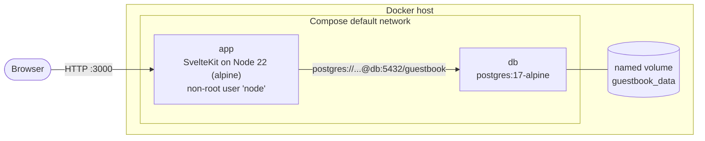
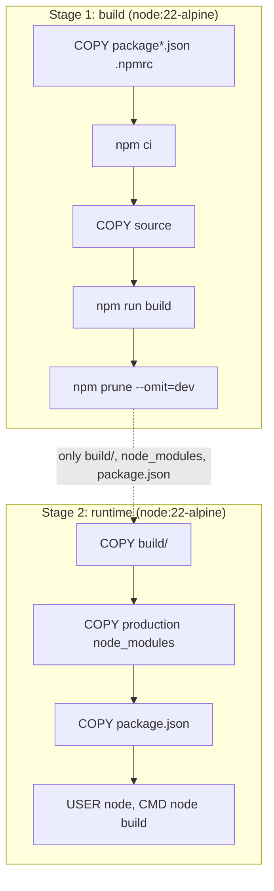
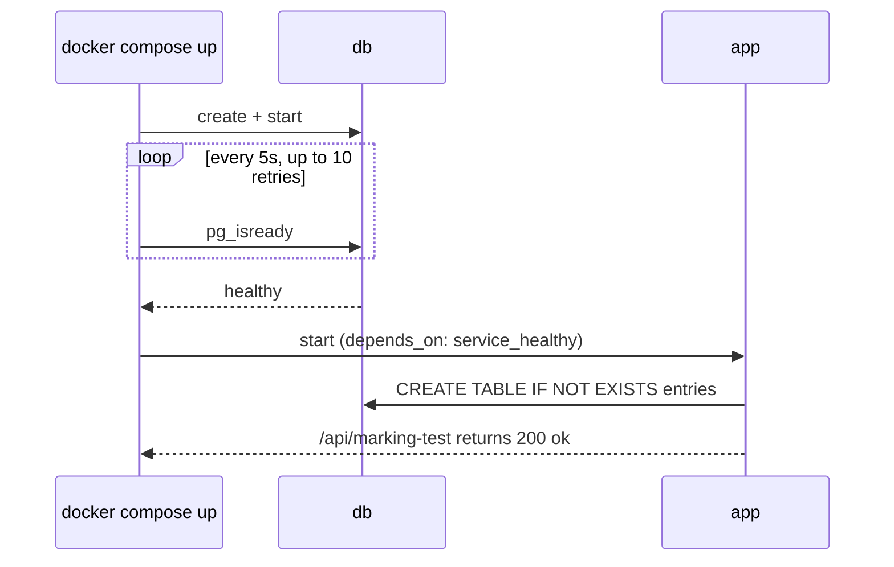

# Architecture

## Overview

The system is a two-container Compose application. The browser only ever talks to the `app`
container; the `db` container is reachable only on the private Compose network.

## Services

### `app`

- Built from the repository `Dockerfile` (`build.context: .`).
- SvelteKit with `@sveltejs/adapter-node`; run with `node build`.
- Configured purely through environment variables:
    - `NODE_ENV=production`
    - `DATABASE_URL=postgres://guestbook:guestbook_pw@db:5432/guestbook`
    - `PORT=3000` / `HOST=0.0.0.0` (image defaults)
- Publishes container port `3000` to host port `3000`.
- Creates its own `entries` table on startup (`CREATE TABLE IF NOT EXISTS`), so no SQL is run by hand.
- Exposes `GET /api/marking-test`, used both by the automarker and by the image `HEALTHCHECK`.

### `db`

- Official `postgres:17-alpine` image.
- Credentials supplied through `POSTGRES_USER`, `POSTGRES_PASSWORD` and `POSTGRES_DB`.
- Data directory `/var/lib/postgresql/data` is backed by the named volume `guestbook_data`.
- `healthcheck` runs `pg_isready`, so other services can wait until it accepts connections.
- **No published ports**: the database is reachable from `app` over the Compose network only.

## Image build (multi-stage)

The runtime image contains no source code, no dev dependencies and no build tooling.
It is about 162 MB, well under the 300 MB good-practice threshold.

## Startup sequence

## Data lifecycle

| Command | Containers | Volume `guestbook_data` | Guestbook data |
| --- | --- | --- | --- |
| `docker compose stop` / `restart` | stopped / restarted | kept | kept |
| `docker compose down` | removed | **kept** | **kept** |
| `docker compose down -v` | removed | **deleted** | **lost** |

## Resilience

Two layers cover the database being unavailable:

1. **Compose level:** `depends_on` with `condition: service_healthy` prevents `app` starting before
   Postgres accepts connections.
2. **Application level:** the provided `hooks.server.ts` retries schema creation with back-off, and the
   `postgres` driver reconnects on its own. This is why the app recovers when only the database is
   restarted (automarker stage 7) without the app container being restarted.
